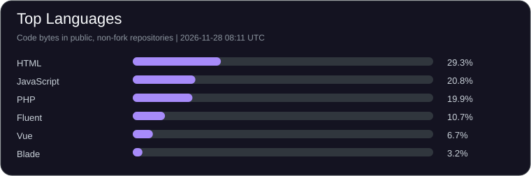
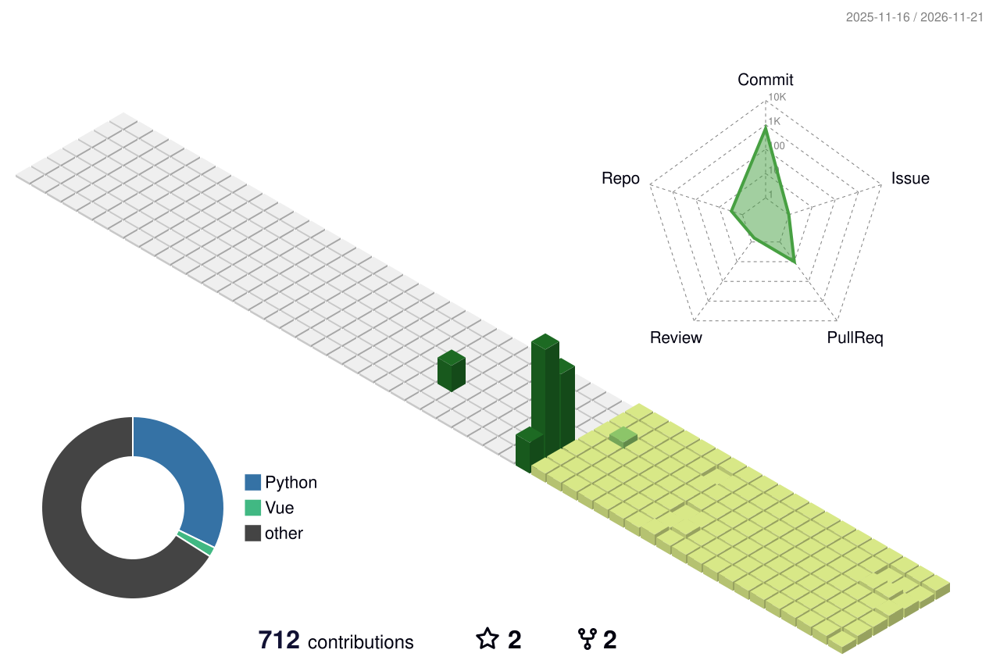

<!-- Profile README for HtLimite -->

  

<h1 align="center">Hi, I'm HtLimite (Reiki)</h1>

前端开发 · 企业级 B 端系统 · 平时爱折腾全栈与 AI 小项目

  <a href="https://wyy.hair/">博客</a> ·
  <a href="https://wyy.hair/projects/">作品集</a> ·
  <a href="https://github.com/HtLimite?tab=repositories">公开仓库</a>

## 关于我

日常主力做前端开发，写过不少供应链和企业级业务系统；工作之外喜欢把想到的点子做成小工具，顺带折腾后端、部署和 AI 应用。写代码常用 AI 提效，但更在意架构边界和最终跑出来的质量。

- **前端：** React、Vue 3、TypeScript、Umi、Vite（复杂表单、权限与中后台业务）
- **后端与数据：** Node.js、Spring Boot、FastAPI ｜ PostgreSQL、MySQL、Redis
- **AI 折腾：** RAG 知识库、Agent 工具调用、工作流编排、AI Coding
- **多端与部署：** uni-app、Cocos Creator ｜ Docker、Linux、Nginx、Jenkins、GitHub Actions

## 折腾过的项目

### 近期主力
- **[AgentFlow-AI](https://github.com/HtLimite/AgentFlow-AI)** — 本地可跑的 AI Agent 与知识库工作流实验项目（Next.js + FastAPI + pgvector），包含 RAG 问答、工具调用审计与可视化画布。
- **[AI 书签导航](https://wyy.hair/posts/9a7b6388/)** `笔记` — 给自己做的云端书签工具（Next.js + Supabase），折腾了多级书签导入、游标分页和异步缩略图生成。
- **[脑洞侦察社](https://wyy.hair/posts/f5d41a8d/)** `笔记` — 微信益智小游戏，从原生 Canvas 迁到 Cocos Creator + TS，顺带摸索了玩法渲染解耦和自动化校验流程。
- **[记忆之词](https://wyy.hair/posts/2910840a/)** `笔记` — 从大学一路重构到现在的背单词与实时对战应用，目前是 uni-app + Vue 3 + Spring Boot。

### 其他公开仓库
- **家政系统练习：** [housekeep-admin-vue](https://github.com/HtLimite/housekeep-admin-vue)（Vue 管理后台）· [housekeep-api](https://github.com/HtLimite/housekeep-api)（后端接口）· [housekeep-foundations](https://github.com/HtLimite/housekeep-foundations) · [housekeep-customer](https://github.com/HtLimite/housekeep-customer)
- **其他实验与存档：** [credit](https://github.com/HtLimite/credit)（Node.js 全栈）· [ai-gemini-report](https://github.com/HtLimite/ai-gemini-report) · [Vue](https://github.com/HtLimite/Vue) · [library](https://github.com/HtLimite/library)
- **站点相关：** 个人技术博客在独立域名 [wyy.hair](https://wyy.hair/)；[HtLimite.github.io](https://github.com/HtLimite/HtLimite.github.io) 是早年的 Todo List 静态页存档。

## GitHub 统计

  
  
  
  

  <picture>
    <source media="(prefers-color-scheme: dark)" srcset="./profile-3d-contrib/profile-night-rainbow.svg" />
    <source media="(prefers-color-scheme: light)" srcset="./profile-3d-contrib/profile-green.svg" />
    
  </picture>

  <picture>
    <source media="(prefers-color-scheme: dark)" srcset="./assets/github-contribution-grid-snake-dark.svg" />
    <source media="(prefers-color-scheme: light)" srcset="./assets/github-contribution-grid-snake.svg" />
    
  </picture>

  以上统计仅涵盖公开仓库，由 GitHub Actions 定期更新

---

Stay curious, keep building.

