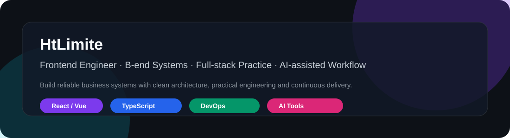
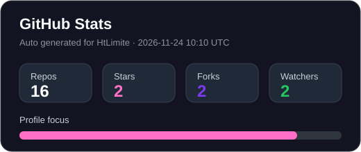
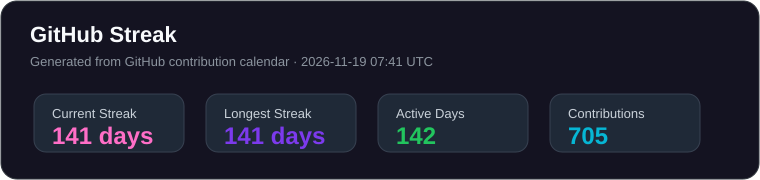
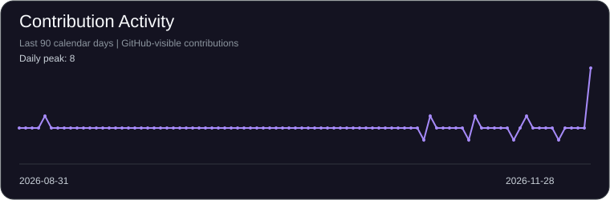

<!-- Profile README for HtLimite -->

<p align="center">
  
</p>

<h1 align="center">HtLimite</h1>
<p align="center">前端工程师 · 企业级业务系统 · AI 应用与全栈实践</p>
<p align="center">
  <a href="https://wyy.hair/">技术博客</a> ·
  <a href="https://wyy.hair/projects/">个人作品</a> ·
  <a href="https://github.com/HtLimite?tab=repositories">公开仓库</a>
</p>

## 01 · 关于我 / About

关注企业级业务系统的工程化交付，从需求拆解、复杂表单与流程、组件设计、接口联调到部署运维。持续实践 AI 应用开发，将模型接入、知识库、工具调用和工作流转化为可验证的工程能力。

- **前端工程：** React、Vue 3、TypeScript、Umi、Vite；复杂表格、表单、权限与业务流程。
- **全栈实践：** Node.js、Spring Boot、FastAPI、PostgreSQL、MySQL、Redis。
- **AI 应用：** RAG、Agent、工具调用、工作流编排、AI 辅助研发与验证。
- **交付与多端：** Docker、Linux、Nginx、Jenkins、GitHub Actions、uni-app、Cocos Creator。

## 02 · 代表项目 / Selected Projects

### AI 应用与工程实践

- **[AgentFlow-AI](https://github.com/HtLimite/AgentFlow-AI)** — AI Agent 与知识库工作流平台的本地可演示版本。Next.js、FastAPI、PostgreSQL、pgvector；涵盖 RAG 问答、工具审计、工作流画布与项目诊断。
- **[AI 书签导航](https://wyy.hair/posts/9a7b6388/)** — Next.js、React、TypeScript 与 Supabase；关注分层书签导入、游标分页、异步缩略图任务和部署。链接为公开工程笔记。
- **[脑洞侦察社](https://wyy.hair/posts/f5d41a8d/)** — 微信小游戏从 Canvas 迁移到 Cocos Creator + TypeScript；关注玩法与渲染解耦、资源生命周期和验证门禁。链接为公开重构笔记。
- **[记忆之词](https://wyy.hair/posts/2910840a/)** — Vue 3、uni-app 与 Spring Boot 的多端重构实践；关注多端兼容、实时对战与状态同步。链接为公开重构笔记。

### 业务系统与全栈基础

- **[housekeep-admin-vue](https://github.com/HtLimite/housekeep-admin-vue)** — Vue 管理后台实践，涉及业务列表、表单及页面组织。
- **[housekeep-api](https://github.com/HtLimite/housekeep-api)** — 家政业务 API 与服务层实践。
- **[credit](https://github.com/HtLimite/credit)** — Node.js 全栈项目实践。

相关公开仓库：[housekeep-foundations](https://github.com/HtLimite/housekeep-foundations) · [housekeep-customer](https://github.com/HtLimite/housekeep-customer) · [ai-gemini-report](https://github.com/HtLimite/ai-gemini-report) · [Vue](https://github.com/HtLimite/Vue) · [library](https://github.com/HtLimite/library)

### 博客与个人站点

- **[Reiki 技术博客](https://wyy.hair/)** — 工程笔记、工具研究、项目总结及个人作品。
- **[HtLimite.github.io](https://github.com/HtLimite/HtLimite.github.io)** — GitHub Pages 历史 Todo List 项目仓库；博客请访问上方独立站点。

## 03 · 工程流程 / Engineering Workflow

```text
需求理解 → 方案拆解 → 开发联调 → 测试验证 → 部署交付 → 复盘优化
```

重视业务正确性、模块边界、可维护性和可验证交付；将 AI 用于需求分析、方案探索、实现和审查，而不是以生成代码代替验证。

## 04 · GitHub 数据 / GitHub Dashboard

<p align="center">
  
  
  
  
</p>

数据由 GitHub Actions 自动更新：仓库统计基于公开自有仓库，语言占比基于公开非 Fork 仓库的代码字节数；贡献统计以 GitHub API 可见的贡献日历及图中日期范围为准，不代表全部历史或工作量。

## 05 · 贡献活动 / Contribution Zone

<p align="center">
  <picture>
    <source media="(prefers-color-scheme: dark)" srcset="./profile-3d-contrib/profile-night-rainbow.svg" />
    <source media="(prefers-color-scheme: light)" srcset="./profile-3d-contrib/profile-green.svg" />
    
  </picture>
</p>

<p align="center">
  <picture>
    <source media="(prefers-color-scheme: dark)" srcset="./assets/github-contribution-grid-snake-dark.svg" />
    <source media="(prefers-color-scheme: light)" srcset="./assets/github-contribution-grid-snake.svg" />
    
  </picture>
</p>

---

<p align="center">持续学习 · 稳定交付 · 用工程化方式解决真实问题</p>
